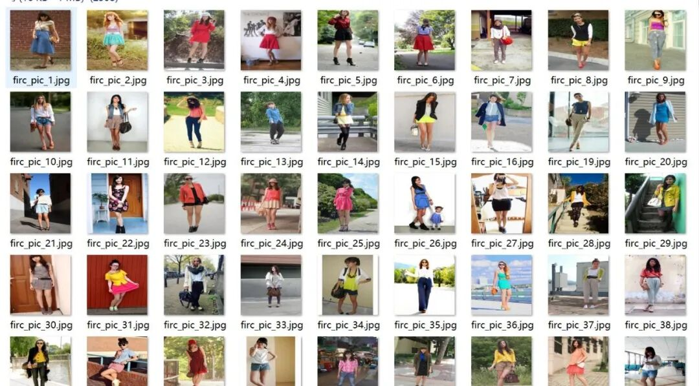
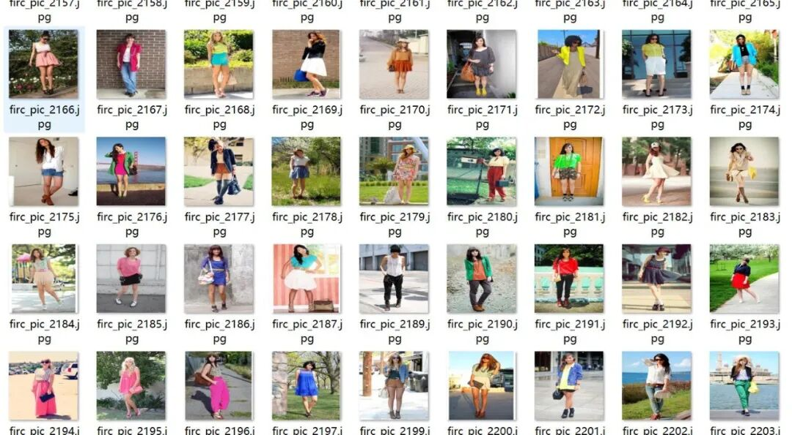
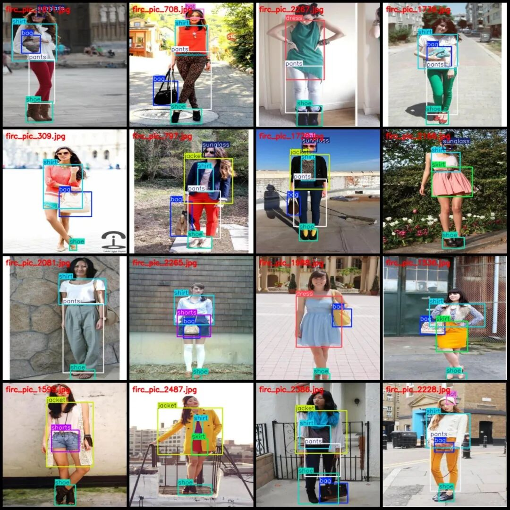
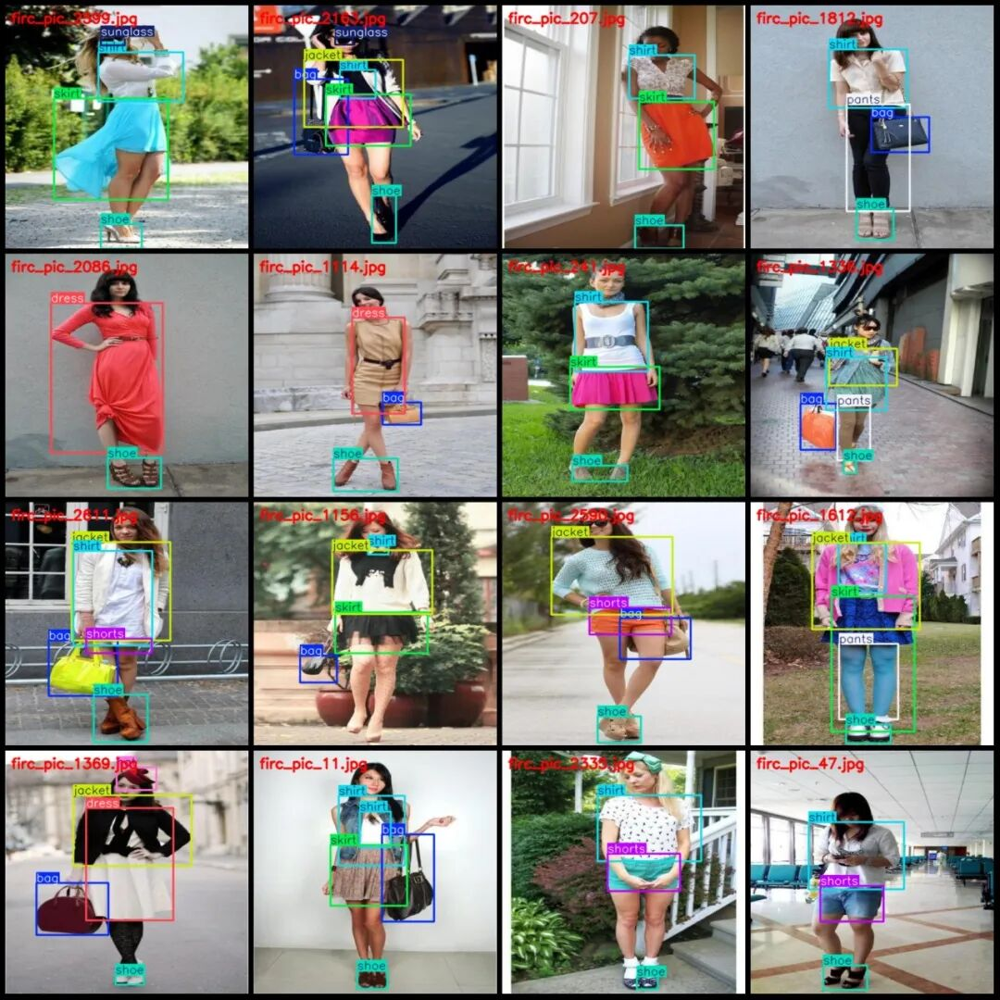
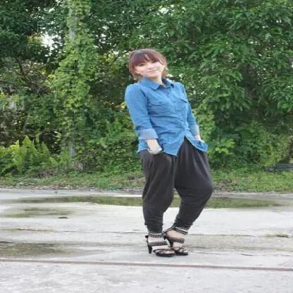
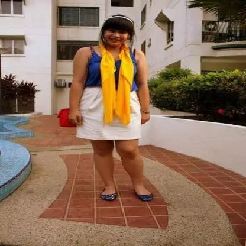
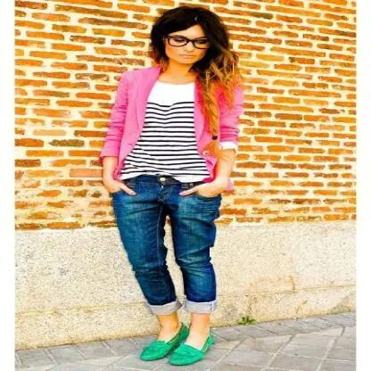

# Clothing Category Identification Detection Dataset VOC+YOLO format with 2682 images in 10 categories

Dataset format: Pascal VOC format + YOLO format (txt file without split path, only contains jpg images and corresponding VOC format xml files and yolo format txt files)

Number of images (number of jpg files): 2682

Number of annotations (number of xml files): 2682

Number of annotations (number of txt files): 2682

Label category count: 10

Label category names (Note that the order of yolo format categories does not correspond to this, but is based on the classes.txt in the labels folder): ["bag", "dress", "hat", "jacket", "pants", "shirt", "shoe", "shorts", "skirt", "sunglass"]

Number of boxes and the number of images occupied by each category:

Bag (package) Frames = 1462, Pictures Taken = 1462

Dress (dress) Frames = 678, Pictures = 678

Number of hats = 350, Number of pictures occupied = 350

Jacket (jacket) Frames = 958, Pictures Taken = 944

Pants (Pants) Frames = 622, Pictures = 622

Shirt (shirt) Frames = 1852, Pictures = 1822

Shoe (Footwear) Frame Count = 2601, Image Count = 2601

Shorts (briefs) Frame Count = 502, Image Count = 502

skirt (Skirts) Frame count = 883, Number of images held = 883

Sunglasses (Sunglasses) Frames = 425, Pictures = 425

Total frames: 10333

Image resolution: 416x416

Using labelImg:

Annotation rules: Draw a rectangle around the category.

Important Notice: The dataset does not have separate training, validation, and test sets; you need to partition them yourself.

Special : This dataset does not guarantee the accuracy of the trained models or weight files.

Image Preview:

Annotation example:

Single image:

## Payment

Here is a pay link on Stripe ( https://buy.stripe.com/3cs8yP7sY87d0vu9AB ). Please contact me lonlonago@foxmail.com after funding $89, and I will send you a complete data files , thank you!

